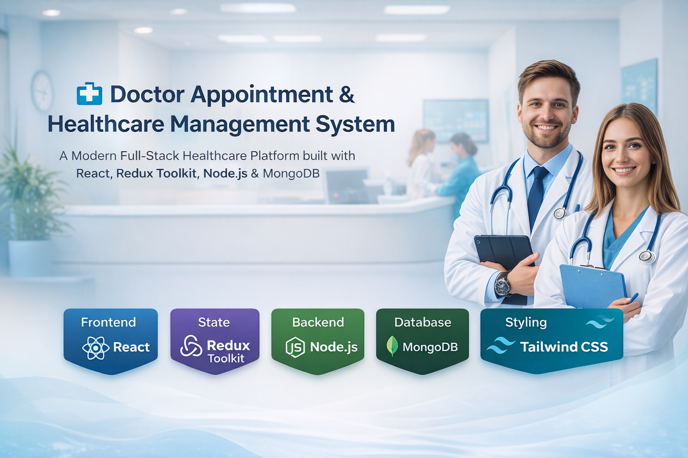

  

<h1 align="center">🏥 Doctor Appointment & Healthcare Management System</h1>

  A Modern Full-Stack Healthcare Platform built with React, Redux Toolkit, Node.js & MongoDB

This platform enables patients to securely authenticate, book appointments, and manage healthcare interactions, while providing scalable backend architecture for real-world deployment.

🚀 Live Features
🔐 Authentication System

Email + OTP Login

Google OAuth Login

Secure JWT-based authentication

Redux Toolkit state management

Protected routes

👨‍⚕️ Patient Features

Register / Login

Book doctor appointments

View appointment history

Responsive mobile-first design

🩺 Doctor Features (Scalable Module)

Doctor profile management

Availability scheduling

Appointment tracking

🛠 Backend Features

RESTful API architecture

MVC folder structure

Profile image uploads use the backend Cloudinary configuration. New uploads are
validated in memory and stored as Cloudinary URLs with their `public_id`;
Cloudinary credentials must remain in the backend environment and must never be
copied into frontend variables.

Existing images in `backend/uploads` are retained and served read-only for
backward compatibility. The migration preview checks both legacy user and
doctor profile references. Preview the legacy image migration first by running
`node scripts/migrate-profile-images.js` from `backend`. After reviewing the
counts, run `node scripts/migrate-profile-images.js --apply` to upload eligible
images and update references. The script does not delete local files; remove
them only after the migrated records and deployed image URLs have been verified
and backed up.

Environment-based configuration

MongoDB integration

Error handling middleware

🏗 Tech Stack
Frontend

⚛ React (Vite)

🧠 Redux Toolkit (State Management)

🎨 Tailwind CSS (Modern UI)

🔐 Firebase Google Authentication

📦 Axios (API handling)

🌐 React Router DOM

Frontend Setup
cd frontend
npm install
npm run dev

Backend

🟢 Node.js

🚀 Express.js

🍃 MongoDB + Mongoose

🔐 JWT Authentication

📁 Multer (File Uploads)

🔑 dotenv (Environment variables)

 Backend Setup
cd backend
npm install
npm run dev